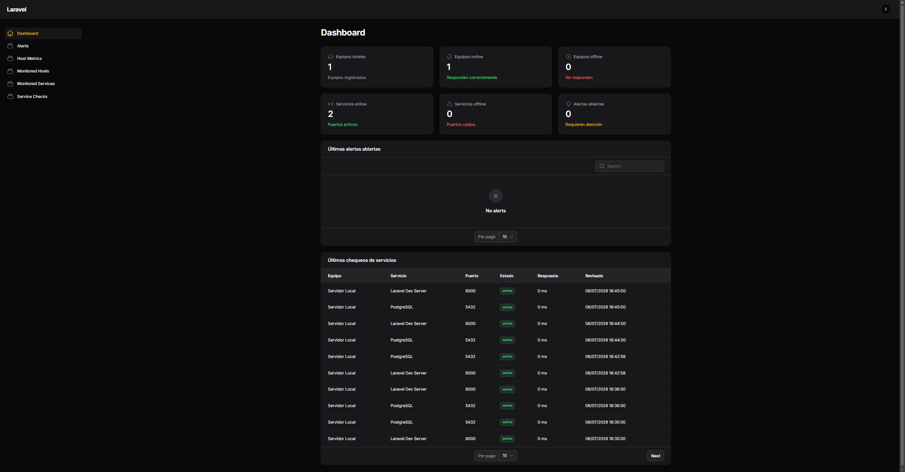
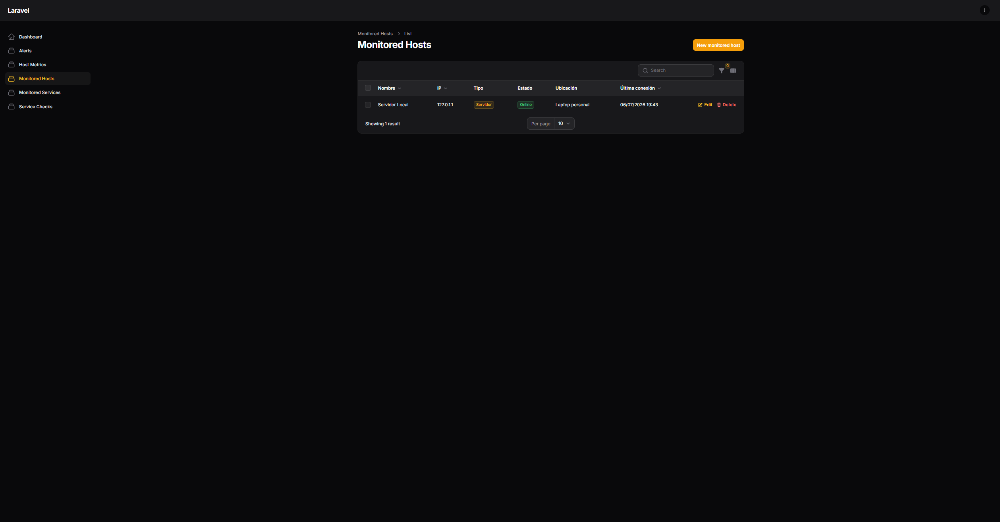
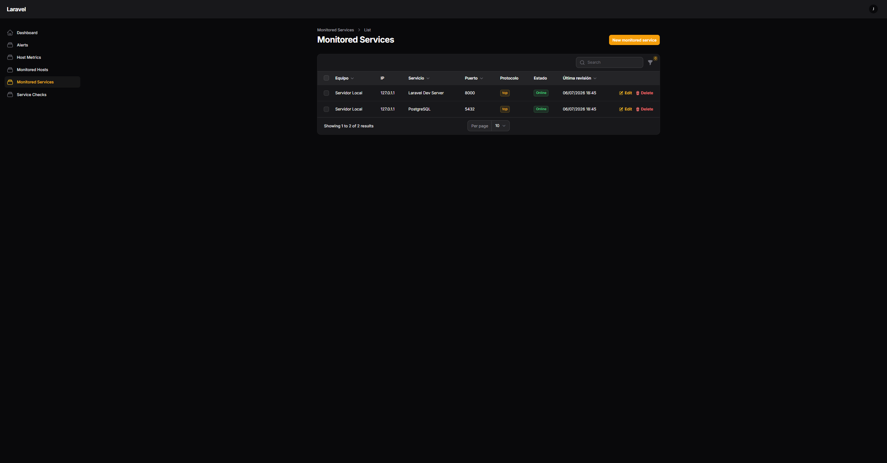
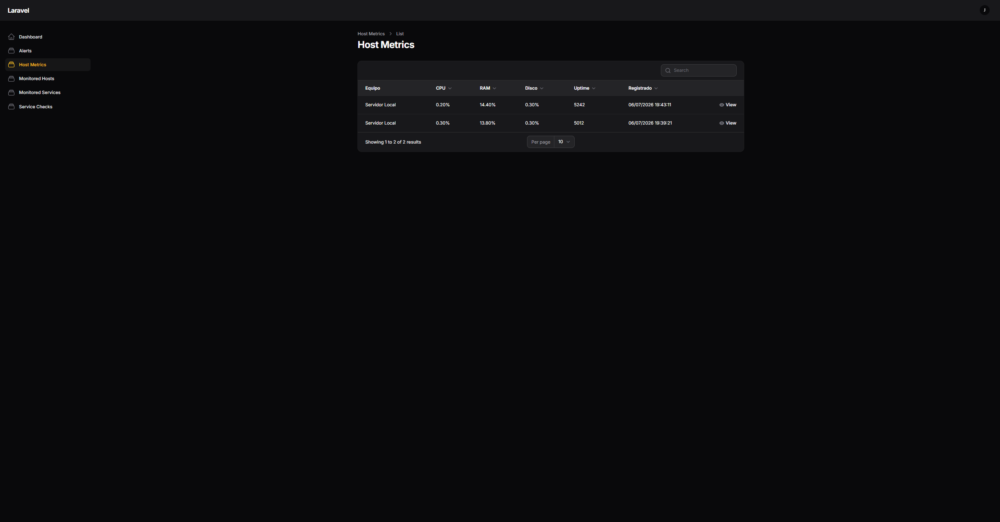
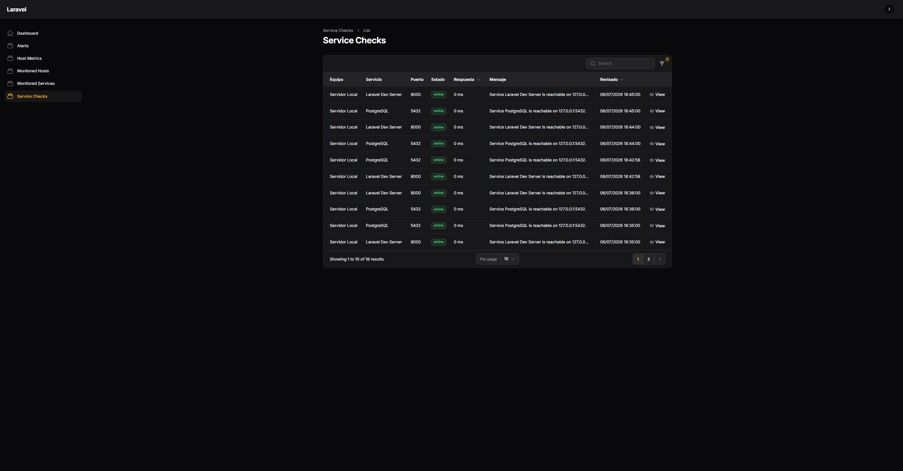
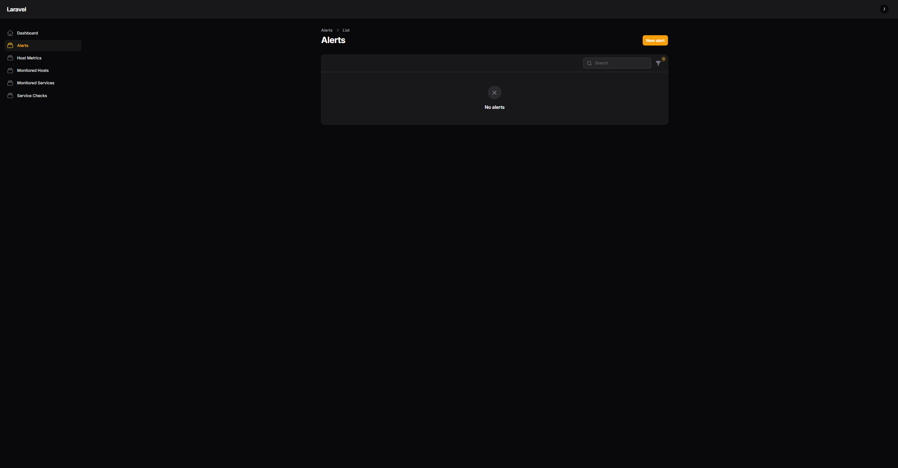

# InfraWatch Monitoring System

**Monitoreo de infraestructura TI con Laravel, Filament, PostgreSQL, agentes Python, alertas Telegram y WebSocket mediante Laravel Reverb.**

[](https://github.com/Josue-Isai-Sanchez-Santos/infrawatch-monitoring-system/actions/workflows/backend-ci.yml)
[](https://github.com/Josue-Isai-Sanchez-Santos/infrawatch-monitoring-system/actions/workflows/agent-ci.yml)
[](https://github.com/Josue-Isai-Sanchez-Santos/infrawatch-monitoring-system/actions/workflows/security-gitleaks.yml)


> **Estado de versiones.** V2.0 es un hito funcional documentado, no necesariamente un tag o release publicado. La rama `master` incorpora correcciones y nuevas pruebas posteriores a ese hito. Consulta [CHANGELOG.md](CHANGELOG.md) y [la política de versiones](docs/releases.md). La versión instalada está determinada por el commit y los archivos de bloqueo, no por esta descripción.

## Qué hace InfraWatch

InfraWatch registra hosts y servicios, comprueba conectividad de **puertos TCP**, recibe métricas por una API autenticada, mantiene historial y genera alertas. Los operadores consultan información en un panel Filament; las notificaciones se envían mediante trabajos en cola hacia Telegram y las actualizaciones del dashboard mediante Laravel Reverb.

- **Inventario y disponibilidad:** hosts, servicios TCP, chequeos y alertas; servicios UDP no se monitorizan como TCP.
- **Agente Python:** CPU, RAM, disco, uptime, hostname, IP y sistema operativo; envíos HTTP con UUID de lectura y reintentos.
- **Recepción segura:** token Bearer por host, validación del payload, límites por token/IP e idempotencia mediante `reading_id`.
- **Panel:** widgets, estadísticas, gráficas de CPU/RAM/disco por host, últimos eventos y top de consumo; criterio cronológico basado en `recorded_at`.
- **Automatización:** Laravel Scheduler, comando `monitor:services`, limpieza `monitor:cleanup` y bloqueo de tareas concurrentes.
- **Alertas:** creación al fallar un servicio, resolución al recuperarse y resolución manual autorizada; envío Telegram desacoplado mediante trabajos.
- **Control de acceso:** `admin`, `technician` y `observer`, mediante Policies; métricas y chequeos son **solo lectura desde Filament**; protección del último administrador.
- **Operación y calidad:** Docker Compose, PostgreSQL, GitHub Actions, Pint, auditorías de dependencias, Gitleaks y pruebas PHP/Python.

## Tecnologías verificadas en `master`

| Capa | Tecnología | Referencia |
|---|---|---|
| Backend | Laravel 13 / PHP 8.4 en Docker | `backend/composer.lock`, `backend/docker/php/Dockerfile` |
| Panel administrativo | Filament 3 / Livewire 3 | `backend/composer.lock` |
| Datos | PostgreSQL 16 | `backend/docker-compose.yml` |
| Agente | Python y `psutil`, `requests`, `python-dotenv` | `agent/requirements.txt` |
| Frontend | Vite 8 / Node 24 en Docker / Laravel Echo | `backend/package.json`, `backend/docker-compose.yml` |
| Tiempo real | Laravel Reverb | `backend/config/reverb.php` |
| Tests | PHPUnit, unittest, GitHub Actions | `backend/tests/`, `agent/tests/`, `.github/workflows/` |

`composer.json` declara PHP `>=8.4.1 <8.6`. No se ha migrado el panel a Filament 5 ni se ha adoptado Laravel 14.

## Arquitectura de alto nivel

```text
[Host monitoreado / agente Python]
                |
                | HTTP POST /api/agent/metrics + Bearer token
                v
        [Laravel / API] ------------------ [Filament / Dashboard]
                |                                  ^
                v                                  | eventos
        [PostgreSQL]                        [Laravel Reverb]
                ^                                  ^
                |                                  |
        [Scheduler / monitor:services] ------ [cola broadcasts]
                |
                +------ [Jobs / Telegram Bot API]
```

El monitor TCP obtiene cada servicio y utiliza `TcpServiceChecker`; las pruebas reemplazan ese componente por un simulador, evitando puertos reales. El monitor TCP no modifica el estado de conexión del agente ni `last_seen_at` de los hosts. Más información: [arquitectura](docs/architecture.md), [modelo de datos](docs/data-model.md), [monitor TCP](docs/tcp-monitoring.md).

## Inicio rápido con Docker Compose (desarrollo)

**Requisitos:** Git, Docker con Compose v2 y espacio para imágenes, dependencias y el volumen de PostgreSQL. No ejecutes esta configuración directamente en Internet: usa `php artisan serve`, `APP_DEBUG=true` y publica puertos pensados para laboratorio.

```bash
# En tu equipo
git clone https://github.com/Josue-Isai-Sanchez-Santos/infrawatch-monitoring-system.git
cd infrawatch-monitoring-system/backend
cp .env.example .env
cp .env.docker.example .env.docker
```

**Antes de iniciar:** modifica `.env.docker` y usa una contraseña local única (`DB_PASSWORD`) y tres identificadores/secretos de Reverb propios. `.env.example` contiene credenciales **desechables**, no credenciales de producción. Laravel dentro de Docker usa `DB_HOST=postgres` por su configuración de Compose; Laravel fuera de Docker usa `127.0.0.1`. No supongas que ambas contraseñas coinciden. Mantén `.env` y `.env.docker` fuera de Git.

```bash
# Desde backend/
docker compose --env-file .env.docker config --quiet
docker compose --env-file .env.docker up -d --build
docker compose --env-file .env.docker exec app php artisan key:generate
docker compose --env-file .env.docker exec app php artisan make:filament-user
```

El usuario creado debe tener `role=admin` para administrar cuentas. No ejecutes `migrate:fresh` sobre datos que quieras conservar. Accede a `http://127.0.0.1:8000/admin` y revisa los logs si el panel no arranca.

```bash
docker compose --env-file .env.docker ps
docker compose --env-file .env.docker logs --tail=100 app
docker compose --env-file .env.docker exec app php artisan migrate:status
```

Para una configuración más detallada, recuperación y copias de seguridad: [instalación](docs/installation.md), [Docker](docs/docker.md), [configuración](docs/configuration.md) y [operación](docs/operations.md).

## Configurar el agente Python

Desde la raíz, en un host que puedas supervisar:

```bash
python3 -m venv agent/.venv
agent/.venv/bin/python -m pip install -r agent/requirements.txt
cp agent/.env.example agent/.env
# Editar API_URL y AGENT_TOKEN de ese host; nunca subir agent/.env
agent/.venv/bin/python agent/agent.py --once
# O ejecución continua:
agent/.venv/bin/python agent/agent.py --interval 60 --silent
```

El token es **por host**; no uses un token global ni publiques ejemplos reales. El modo `--verbose` aumenta el detalle en los logs, `--silent` evita salida en consola, pero conserva el archivo de logs. Consulta [agente](agent/README.md) y [operación de agentes](docs/agent-operations.md).

## Comandos y pruebas

```bash
cd backend
docker compose --env-file .env.docker exec app php artisan monitor:services
docker compose --env-file .env.docker exec app php artisan monitor:cleanup --days=30 --dry-run
docker compose --env-file .env.docker exec app ./vendor/bin/pint --test
docker compose --env-file .env.docker exec app composer audit --locked --no-interaction
```

En el entorno local del proyecto se registraron **82 pruebas PHP (606 aserciones) y 15 pruebas del agente aprobadas** durante la revisión de noviembre de 2026. Son un resultado histórico, **no una garantía de que cualquier commit futuro pase**. La CI emplea PostgreSQL para las pruebas de Laravel; localmente también se pueden ejecutar con SQLite en memoria. [Guía de pruebas y CI](docs/testing-ci.md).

## Permisos esenciales

| Acción | Administrador | Técnico | Observador |
|---|---|---|---|
| Consultar infraestructura e historial | Sí | Sí | Sí |
| Crear/editar hosts y servicios | Sí | Sí | No |
| Resolver alertas | Sí | Sí | No |
| Gestionar usuarios | Sí | No | No |
| Eliminar hosts o servicios | Sí | No | No |
| Crear/editar/eliminar métricas y chequeos desde Filament | No | No | No |
| Eliminación masiva de usuarios | No | No | No |

El administrador no puede eliminarse a sí mismo ni cambiar su propio rol desde la administración; las operaciones de otros administradores protegen la última cuenta administrativa. Consulta [modelo de permisos](docs/security-model.md). La eliminación de hosts y servicios puede tener efectos por claves foráneas: una Policy de Filament **no equivale a inmutabilidad absoluta en la base de datos**.

## Documentación

Comienza por el [índice de documentación](docs/index.md). Incluye guías de instalación, arquitectura, base de datos, API, seguridad, operación, contribuciones, pruebas, diagnóstico, versiones y hoja de ruta. Existen además guías específicas de [Telegram](docs/telegram.md), [WebSockets](docs/realtime-websockets.md) y [servicio Linux](docs/agent-service-linux.md).

## Capturas

| Dashboard | Hosts | Servicios |
|---|---|---|
|  |  |  |

| Métricas | Chequeos | Alertas |
|---|---|---|
|  |  |  |

## Contribución en XERJ Corpus Hub

El autor figura como contribuidor de **[XERJ Corpus Hub](https://hub.xerj.org/contributors/Josue-Isai-Sanchez-Santos)**, cuya [lista pública](https://hub.xerj.org/contributors/list.15) identifica su cuenta. La inclusión corresponde a una revisión indexada del proyecto; **no implica que las versiones posteriores de `master` estén indexadas automáticamente**. Detalles y límites: [docs/xerj.md](docs/xerj.md).

## Seguridad, colaboración y licencias

- [SECURITY.md](SECURITY.md): versiones mantenidas y reporte **privado** de vulnerabilidades; nunca publicar claves, tokens, datos personales o exploits sin coordinar.
- [CONTRIBUTING.md](CONTRIBUTING.md): ramas, desarrollo, estilo y pull requests.
- [CHANGELOG.md](CHANGELOG.md): historial y cambios pendientes sin inventar releases.
- [CODE_OF_CONDUCT.md](CODE_OF_CONDUCT.md): convivencia de colaboradores.
- [LICENSE](LICENSE): MIT.

**Autor:** [Josué Isaí Sánchez Santos](https://github.com/Josue-Isai-Sanchez-Santos). Proyecto de portafolio técnico y colaboración de código abierto; sin garantía de disponibilidad para entornos críticos.
